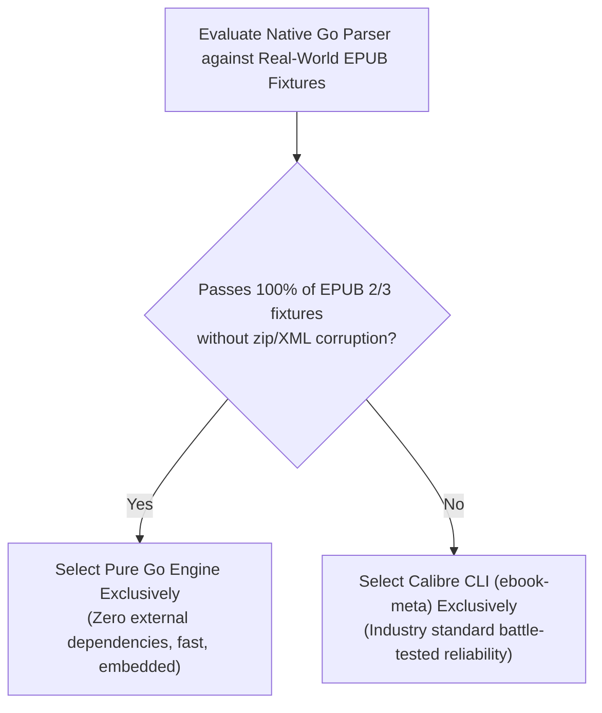
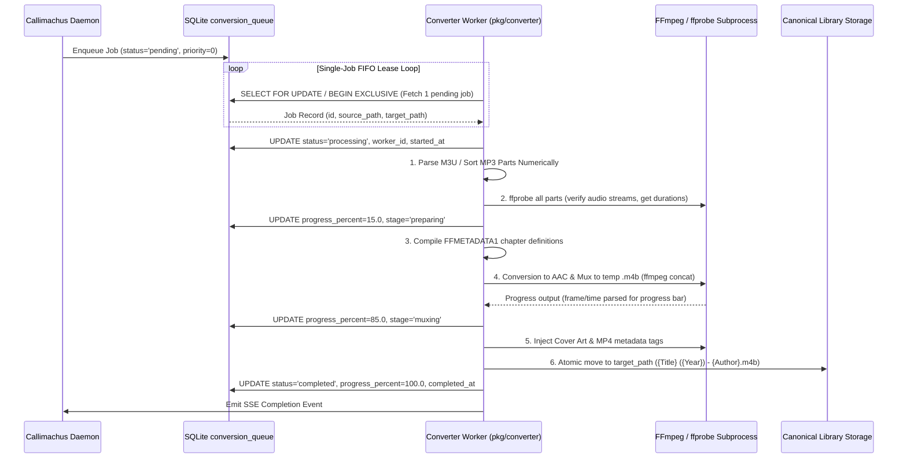
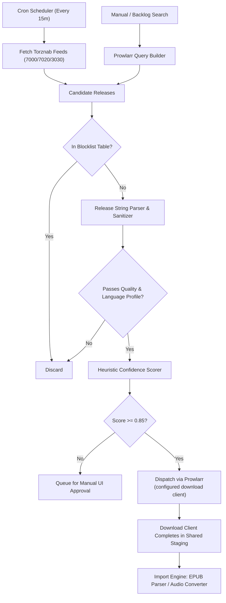
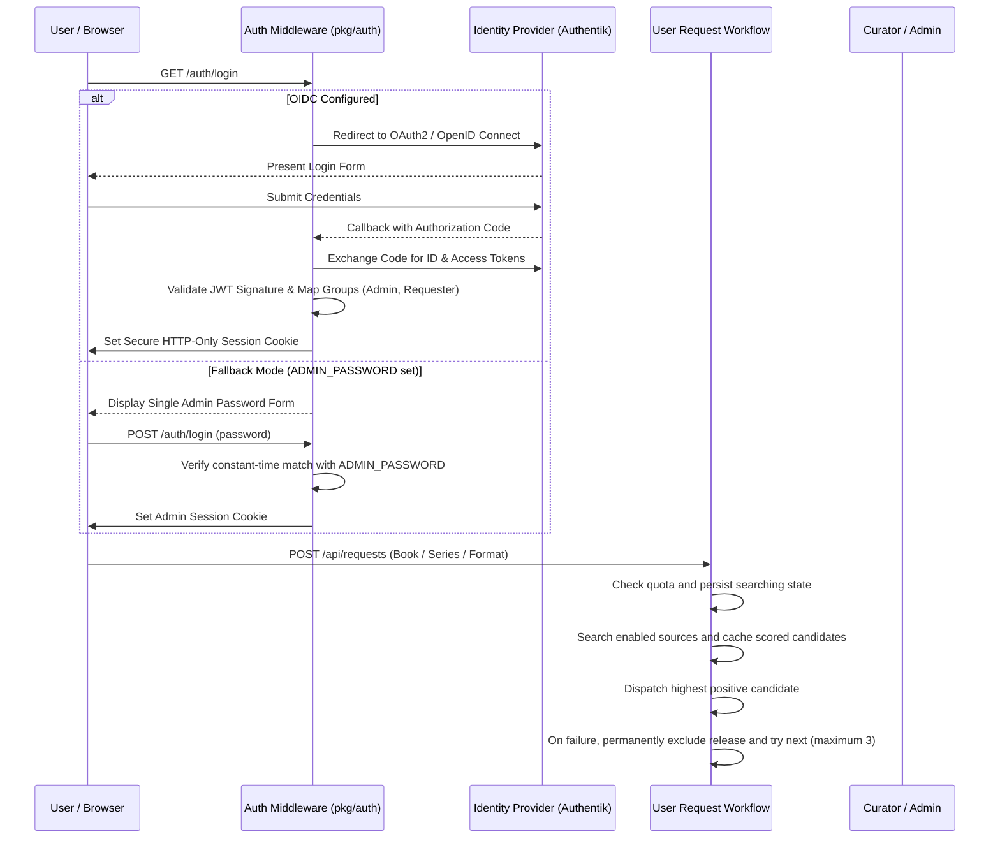

# Callimachus: Technical Architecture Specification

> **Document Version:** 1.0.0  
> **Status:** Approved Architecture Baseline  
> **Repository:** `t0ggl/callimachus`  
> **Target Stack:** Go 1.23+ (Embedded SQLite / WAL), React 18+ / Vite / Tailwind CSS, Decoupled Audio Converter (FFmpeg)

---

## 1. System Overview & Component Topology

**Callimachus** is an automated cataloging, acquisition, curation, and library management daemon for eBooks and Audiobooks. Adopting the declarative management pattern of the `*arr` ecosystem, Callimachus operates as a continuous state machine orchestrating search indexers, torrent/Usenet download clients, metadata providers, file parsers, conversion workers, and media servers.

```mermaid
flowchart TD
    subgraph UI ["Client Layer (React / Vite / Tailwind)"]
        WebUI["Impeccable Web UI (SPA)"]
        SSEStream["SSE / WebSocket Progress Events"]
    end

    subgraph Core ["Callimachus Daemon (cmd/callimachus)"]
        API["REST & RPC HTTP API Router (chi/net/http)"]
        AuthMid["Auth Middleware (OIDC / Session / Admin Fallback)"]
        CatalogMgr["Catalog Manager (pkg/catalog)"]
        Scheduler["Acquisition Daemon & RSS Syncer"]
        MetadataEngine["Metadata Pipeline (pkg/metadata)"]
        EPUBEngine["EPUB Engine (pkg/epub)"]
        DownloaderMgr["Download Coordinator (pkg/downloaders)"]
        QueueMgr["Conversion Queue Coordinator"]
        DB[(Embedded SQLite WAL DB pkg/database)]
    end

    subgraph ConversionWorker ["Decoupled Converter (cmd/callimachus-worker)"]
        WorkerQueue["FIFO Queue Consumer (Single Job)"]
        FFmpegRunner["FFmpeg AAC Encoder & Muxer (pkg/converter)"]
        ChapterGen["FFMETADATA1 Chapter Generator"]
        TagInject["Cover & Tag Injector"]
        AtomicMover["Atomic Library Publisher"]
    end

    subgraph External ["External Services & Infrastructure"]
        OIDC["OIDC Provider (Authentik / Authelia / Keycloak)"]
        Prowlarr["Prowlarr (Torznab / Newznab)"]
        Clients["Download Clients (qBittorrent / SABnzbd)"]
        MetaSources["Metadata APIs (Hardcover / Audnexus / OpenLibrary)"]
        MediaServers["Downstream Media Servers (Audiobookshelf / Calibre-Web)"]
        CalibreCLI["Optional Host CLI (ebook-meta)"]
    end

    WebUI -->|HTTP / REST| API
    API --> SSEStream
    SSEStream -->|Live Queue / Conversion Progress| WebUI
    API --> AuthMid
    AuthMid --> OIDC
    API --> CatalogMgr
    Scheduler -->|Torznab RSS Sync & Queries| Prowlarr
    API -->|JSON Search & Release Grab| Prowlarr
    Prowlarr -->|Torrent / Usenet Dispatch| Clients
    Clients -->|Completed Downloads in Shared Staging| DownloaderMgr
    DownloaderMgr -->|Inspection & Normalization| MetadataEngine
    MetadataEngine -->|Deterministic / Audnexus / Hardcover| MetaSources
    CatalogMgr --> DB
    QueueMgr -->|Enqueue Multi-Part Audiobooks| DB
    WorkerQueue -->|Poll FIFO Pending Job (Single-Worker Lease)| DB
    WorkerQueue --> FFmpegRunner
    FFmpegRunner --> ChapterGen
    ChapterGen --> TagInject
    TagInject --> AtomicMover
    EPUBEngine -->|Native Parser / Validator| DB
    EPUBEngine -.->|Optional CLI Fallback| CalibreCLI
    CatalogMgr -->|Library Scanner / Webhooks| MediaServers
```

### 1.1 Architectural Guarantees
1. **Decoupled Workloads:** Heavy audio converting CPU workloads run in a single-job FIFO worker (`callimachus-worker`), preventing conversion spikes from starving HTTP request serving, indexer polling, or file indexing.
2. **Single Database with WAL Mode:** A single embedded SQLite database (`callimachus.db`) with Write-Ahead Logging (`WAL`) provides concurrent read access and safe serialized writes with zero external database server operational overhead.
3. **Zero-Symlink Storage Contract:** Audiobooks and eBooks reside under identical basenames in canonical author/series hierarchies. Audiobooks are never symlinked or aliased.
4. **Deterministic Metadata Isolation:** The primary ingestion and match pipeline relies entirely on deterministic scoring (Levenshtein, token overlap, Audnexus ASIN lookup, Hardcover IDs). AI disambiguation is an isolated, opt-in fallback that can be completely disabled without degradation.
5. **100% Offline Testability:** Every parser, tokenizer, metadata matcher, Torznab XML reader, OPF generator, and filename formatter must have comprehensive unit tests with zero runtime network requirements.

---

## 2. Go Package & Directory Structure

Callimachus follows standard Go project conventions with strict package isolation:

```
callimachus/
├── cmd/
│   ├── callimachus/                  # Main daemon: HTTP server, background schedulers, embedded worker runner
│   │   └── main.go
│   └── callimachus-worker/           # Standalone single-job conversion worker binary (for multi-container/node scale)
│       └── main.go
├── pkg/
│   ├── catalog/                      # Book, author, series, narrator domain aggregates & library scanner
│   │   ├── author.go
│   │   ├── book.go
│   │   ├── edition.go
│   │   ├── narrator.go
│   │   ├── series.go
│   │   ├── scanner.go                # Filesystem scanner and library tree reconciler
│   │   └── organizer.go              # Canonical path resolution & atomic move logic
│   ├── metadata/                     # Multi-source metadata ingestion & heuristic confidence scoring
│   │   ├── provider.go               # Provider interfaces and normalized domain metadata structs
│   │   ├── hardcover/                # Hardcover GraphQL/REST client
│   │   ├── audnexus/                 # Audnexus Audible ASIN client (chapters, narrator credits, covers)
│   │   ├── openlibrary/              # OpenLibrary / Google Books fallback clients
│   │   ├── sanitizer.go              # Scene release tag stripper, title/author normalizer
│   │   ├── scorer.go                 # Deterministic fuzzy heuristic confidence scorer (0.00 - 1.00)
│   │   └── ai/                       # Optional opt-in LLM disambiguation driver (OpenAI/Anthropic/Local)
│   ├── epub/                         # EPUB 2/3 inspection, schema validation, and metadata writer
│   │   ├── container.go              # Pure Go ZIP & META-INF/container.xml parser
│   │   ├── opf.go                    # Calibre-compatible OPF parser & writer
│   │   ├── validator.go              # EPUB schema and namespace validation
│   │   ├── writer.go                 # Safe ZIP repacker (guarantees mimetype first, uncompressed)
│   │   ├── calibre_cli.go            # Optional fallback driver for host `ebook-meta` CLI
│   │   └── sidecar.go                # Calibre companion .opf and cover .jpg generator
│   ├── converter/                   # Audio processing, M3U ordering, chapter generator, FFmpeg runner
│   │   ├── queue.go                  # SQLite-backed FIFO queue lease and progress reporter
│   │   ├── worker.go                 # Converter worker execution loop
│   │   ├── probe.go                  # ffprobe audio analyzer (duration, codecs, sample rate, bitrate)
│   │   ├── playlist.go               # Multi-part sorting & M3U parsing
│   │   ├── chapters.go               # FFMETADATA1 chapter file compiler
│   │   └── muxer.go                  # FFmpeg single-pass / two-pass AAC conversion & M4B muxer
│   ├── indexers/                     # Prowlarr Torznab/Newznab indexer client & search query engine
│   │   ├── client.go                 # Torznab XML client
│   │   ├── prowlarr.go               # Prowlarr API integration
│   │   ├── query.go                  # Book/author/edition search query builder
│   │   ├── parser.go                 # Torznab XML item & attribute extractor
│   │   └── sync.go                   # Periodic RSS feed sync manager
│   ├── downloaders/                  # Completed-download ingestion & quality policies
│   │   ├── staging.go                # Completed-only directory monitor & post-processing dispatcher
│   │   ├── profile.go                # Release quality policy
│   │   └── blocklist.go              # Info-hash & release blocklist enforcement
│   ├── auth/                         # Authentication & RBAC
│   │   ├── oidc.go                   # OIDC token validation & claim mapping (Authentik, Keycloak, Authelia)
│   │   ├── session.go                # Encrypted cookie session manager
│   │   ├── fallback.go               # Single-password ADMIN_PASSWORD fallback
│   │   └── rbac.go                   # Role permissions (Admin, Curator, Requester, Guest)
│   ├── database/                     # SQLite database access & migrations
│   │   ├── database.go               # Connection pooling, WAL configuration, PRAGMA setup
│   │   ├── migrations/               # Embedded SQL migration files (embed.FS)
│   │   │   ├── 0001_initial_schema.sql
│   │   │   └── ...
│   │   └── migrate.go                # Lightweight zero-dependency migration runner
│   └── notify/                       # Downstream library scan triggers & webhooks
│       ├── audiobookshelf.go         # Audiobookshelf library scan trigger
│       ├── calibre_web.go            # Calibre-Web library reload trigger
│       └── webhook.go                # Custom webhook dispatcher
├── web/                              # React / Vite / Tailwind frontend SPA
│   ├── index.html
│   ├── package.json
│   ├── vite.config.ts
│   ├── tailwind.config.ts
│   └── src/
│       ├── api/                      # Typed API clients & SSE listeners
│       ├── components/               # Impeccable UI components
│       ├── hooks/                    # Keyboard shortcuts, data fetching hooks
│       ├── pages/                    # Catalog, Queue, Requests, Settings
│       └── types/                    # Domain TypeScript definitions
├── testdata/                         # Offline test fixtures (0 network in tests)
│   ├── epubs/                        # Real-world valid and malformed EPUB 2/3 samples
│   ├── torznab/                      # Sample Torznab XML RSS & search responses
│   ├── metadata/                     # Recorded JSON payloads from Hardcover, Audnexus, OpenLibrary
│   ├── audio/                        # Tiny mock audio files (MP3/AAC) with test ID3/chapter tags
│   └── release_names.txt             # 500+ raw release strings with expected parsed assertions
├── Dockerfile
├── docker-compose.yml
├── Makefile
└── go.mod
```

---

## 3. Relational Database Schema & SQLite Configuration

### 3.1 SQLite Engine Pragmas & Configuration
Callimachus leverages SQLite as an embedded, zero-maintenance relational database using `modernc.org/sqlite` (pure Go, CGO-free) or `github.com/mattn/go-sqlite3`. To ensure ultra-fast throughput, read-write concurrency, and zero corruption, the database connection pool is configured with the following PRAGMAs on every connection open:

```sql
PRAGMA journal_mode = WAL;
PRAGMA synchronous = NORMAL;
PRAGMA foreign_keys = ON;
PRAGMA busy_timeout = 5000;
PRAGMA cache_size = -64000;         -- 64MB cache
PRAGMA temp_store = MEMORY;
PRAGMA auto_vacuum = INCREMENTAL;
```

### 3.2 Full DDL Specifications

```sql
-- Migration 0001_initial_schema.sql

-- 1. Authors
CREATE TABLE authors (
    id TEXT PRIMARY KEY,                       -- UUIDv4 / ULID
    name TEXT NOT NULL,                        -- e.g. "Brandon Sanderson"
    sort_name TEXT NOT NULL,                   -- e.g. "Sanderson, Brandon"
    aliases TEXT NOT NULL DEFAULT '[]',        -- JSON array of alternate names
    photo_url TEXT,
    biography TEXT,
    created_at TIMESTAMP NOT NULL DEFAULT CURRENT_TIMESTAMP,
    updated_at TIMESTAMP NOT NULL DEFAULT CURRENT_TIMESTAMP
);
CREATE INDEX idx_authors_name ON authors(name);
CREATE INDEX idx_authors_sort_name ON authors(sort_name);

-- 2. Narrators (First-class audiobook entities)
CREATE TABLE narrators (
    id TEXT PRIMARY KEY,                       -- UUIDv4 / ULID
    name TEXT NOT NULL,                        -- e.g. "Michael Kramer"
    sort_name TEXT NOT NULL,                   -- e.g. "Kramer, Michael"
    aliases TEXT NOT NULL DEFAULT '[]',        -- JSON array of aliases
    photo_url TEXT,
    biography TEXT,
    created_at TIMESTAMP NOT NULL DEFAULT CURRENT_TIMESTAMP,
    updated_at TIMESTAMP NOT NULL DEFAULT CURRENT_TIMESTAMP
);
CREATE INDEX idx_narrators_name ON narrators(name);

-- 3. Series
CREATE TABLE series (
    id TEXT PRIMARY KEY,                       -- UUIDv4 / ULID
    title TEXT NOT NULL,                       -- e.g. "The Stormlight Archive"
    description TEXT,
    total_books INTEGER,                       -- Expected total count if known
    status TEXT NOT NULL DEFAULT 'ongoing',    -- 'ongoing', 'completed', 'hiatus'
    created_at TIMESTAMP NOT NULL DEFAULT CURRENT_TIMESTAMP,
    updated_at TIMESTAMP NOT NULL DEFAULT CURRENT_TIMESTAMP
);
CREATE INDEX idx_series_title ON series(title);

-- 4. Books (Abstract Work)
CREATE TABLE books (
    id TEXT PRIMARY KEY,                       -- UUIDv4 / ULID
    author_id TEXT NOT NULL REFERENCES authors(id) ON DELETE CASCADE,
    series_id TEXT REFERENCES series(id) ON DELETE SET NULL,
    series_index REAL,                         -- float64: supports 1.0, 1.5, 2.0, 2.5
    series_index_display TEXT,                 -- Display override, e.g. "#1.5", "Book 2"
    title TEXT NOT NULL,                       -- e.g. "The Way of Kings"
    subtitle TEXT,
    release_date TEXT,                         -- ISO-8601 date YYYY-MM-DD
    synopsis TEXT,
    genres TEXT NOT NULL DEFAULT '[]',         -- JSON array of genre strings
    monitored INTEGER NOT NULL DEFAULT 1,      -- 1 = true, 0 = false
    created_at TIMESTAMP NOT NULL DEFAULT CURRENT_TIMESTAMP,
    updated_at TIMESTAMP NOT NULL DEFAULT CURRENT_TIMESTAMP
);
CREATE INDEX idx_books_author_id ON books(author_id);
CREATE INDEX idx_books_series_id ON books(series_id);
CREATE INDEX idx_books_series_order ON books(series_id, series_index);
CREATE INDEX idx_books_monitored ON books(monitored);

-- 5. Book Editions (Physical / Digital Formats)
CREATE TABLE book_editions (
    id TEXT PRIMARY KEY,                       -- UUIDv4 / ULID
    book_id TEXT NOT NULL REFERENCES books(id) ON DELETE CASCADE,
    format TEXT NOT NULL,                      -- 'epub', 'm4b', 'pdf', 'azw3'
    isbn13 TEXT,
    asin TEXT,
    hardcover_id TEXT,
    openlibrary_id TEXT,
    goodreads_id TEXT,
    publisher TEXT,
    publication_date TEXT,
    language TEXT NOT NULL DEFAULT 'en',       -- ISO 639-1 code
    monitored INTEGER NOT NULL DEFAULT 1,
    created_at TIMESTAMP NOT NULL DEFAULT CURRENT_TIMESTAMP,
    updated_at TIMESTAMP NOT NULL DEFAULT CURRENT_TIMESTAMP
);
CREATE INDEX idx_editions_book_id ON book_editions(book_id);
CREATE INDEX idx_editions_format ON book_editions(format);
CREATE INDEX idx_editions_isbn13 ON book_editions(isbn13);
CREATE INDEX idx_editions_asin ON book_editions(asin);

-- 6. Edition Narrators (Many-to-Many Narrator mapping)
CREATE TABLE edition_narrators (
    edition_id TEXT NOT NULL REFERENCES book_editions(id) ON DELETE CASCADE,
    narrator_id TEXT NOT NULL REFERENCES narrators(id) ON DELETE CASCADE,
    role TEXT NOT NULL DEFAULT 'primary',      -- 'primary', 'co-narrator', 'full_cast'
    PRIMARY KEY (edition_id, narrator_id)
);
CREATE INDEX idx_edition_narrators_narrator ON edition_narrators(narrator_id);

-- 7. Media Assets (Files stored on disk)
CREATE TABLE media_assets (
    id TEXT PRIMARY KEY,                       -- UUIDv4 / ULID
    edition_id TEXT NOT NULL REFERENCES book_editions(id) ON DELETE CASCADE,
    file_path TEXT NOT NULL UNIQUE,            -- Canonical path on disk
    file_size INTEGER NOT NULL,                -- Bytes
    checksum TEXT,                             -- SHA256 / MD5
    audio_codec TEXT,                          -- 'aac', 'mp3', NULL for epub
    bitrate INTEGER,                           -- In bps (e.g. 128000)
    sample_rate INTEGER,                       -- In Hz (e.g. 44100)
    channels INTEGER,                          -- e.g. 2
    duration_seconds REAL,                     -- Audio duration
    chapters TEXT NOT NULL DEFAULT '[]',       -- JSON array of chapter timestamps & titles
    is_verified INTEGER NOT NULL DEFAULT 0,    -- 1 if passed integrity check
    created_at TIMESTAMP NOT NULL DEFAULT CURRENT_TIMESTAMP,
    updated_at TIMESTAMP NOT NULL DEFAULT CURRENT_TIMESTAMP
);
CREATE INDEX idx_media_assets_edition ON media_assets(edition_id);
CREATE UNIQUE INDEX idx_media_assets_path ON media_assets(file_path);

-- 8. Conversion Queue (Decoupled Single-Worker FIFO Pipeline)
CREATE TABLE conversion_queue (
    id TEXT PRIMARY KEY,                       -- UUIDv4 / ULID
    edition_id TEXT NOT NULL REFERENCES book_editions(id) ON DELETE CASCADE,
    source_path TEXT NOT NULL,                 -- Source staging directory or file
    target_path TEXT NOT NULL,                 -- Target canonical .m4b path
    status TEXT NOT NULL DEFAULT 'pending',    -- 'pending', 'processing', 'completed', 'failed', 'cancelled'
    progress_percent REAL NOT NULL DEFAULT 0.0,
    current_stage TEXT NOT NULL DEFAULT 'queued', -- 'preparing', 'converting', 'muxing', 'tagging', 'moving'
    error_message TEXT,
    worker_id TEXT,                            -- ID of worker leasing the job
    attempts INTEGER NOT NULL DEFAULT 0,
    max_attempts INTEGER NOT NULL DEFAULT 3,
    priority INTEGER NOT NULL DEFAULT 0,       -- Higher executes first
    created_at TIMESTAMP NOT NULL DEFAULT CURRENT_TIMESTAMP,
    updated_at TIMESTAMP NOT NULL DEFAULT CURRENT_TIMESTAMP,
    started_at TIMESTAMP,
    completed_at TIMESTAMP
);
CREATE INDEX idx_conversion_status_priority ON conversion_queue(status, priority DESC, created_at ASC);

-- 9. Indexers (Prowlarr Torznab / Newznab sources)
CREATE TABLE indexers (
    id TEXT PRIMARY KEY,
    name TEXT NOT NULL,
    protocol TEXT NOT NULL,                    -- 'torznab', 'newznab'
    url TEXT NOT NULL,
    api_key TEXT NOT NULL,
    categories TEXT NOT NULL DEFAULT '[7000, 7020, 3030]', -- JSON array of cat IDs
    enabled INTEGER NOT NULL DEFAULT 1,
    priority INTEGER NOT NULL DEFAULT 1,
    last_sync_at TIMESTAMP,
    created_at TIMESTAMP NOT NULL DEFAULT CURRENT_TIMESTAMP,
    updated_at TIMESTAMP NOT NULL DEFAULT CURRENT_TIMESTAMP
);

-- Direct client configuration removed by migration 0004; Prowlarr owns clients.

-- 11. Download Queue (Active / Ingested client tasks)
CREATE TABLE download_queue (
    id TEXT PRIMARY KEY,
    client_id TEXT NOT NULL DEFAULT 'prowlarr', -- Historical attribution, no direct client configuration
    edition_id TEXT REFERENCES book_editions(id) ON DELETE SET NULL,
    download_client_task_id TEXT NOT NULL,     -- Hash or client job ID
    title TEXT NOT NULL,                       -- Release title
    protocol TEXT NOT NULL,                    -- 'torrent', 'usenet'
    info_hash TEXT,                            -- Torrent info-hash
    status TEXT NOT NULL DEFAULT 'queued',     -- 'queued', 'downloading', 'completed', 'staged', 'importing', 'failed'
    progress_percent REAL NOT NULL DEFAULT 0.0,
    size_bytes INTEGER NOT NULL DEFAULT 0,
    staging_path TEXT,                         -- Filesystem path where download finished
    error_message TEXT,
    created_at TIMESTAMP NOT NULL DEFAULT CURRENT_TIMESTAMP,
    updated_at TIMESTAMP NOT NULL DEFAULT CURRENT_TIMESTAMP
);
CREATE INDEX idx_download_queue_client_task ON download_queue(client_id, download_client_task_id);
CREATE INDEX idx_download_queue_status ON download_queue(status);

-- 12. Blocklist (Blacklisted info-hashes & failed releases)
CREATE TABLE blocklist (
    id TEXT PRIMARY KEY,
    info_hash TEXT UNIQUE,                     -- Normalized lowercase 40-char hex
    title TEXT NOT NULL,
    indexer_name TEXT,
    reason TEXT NOT NULL,                      -- e.g. "corrupt audio", "unparseable zip", "manual reject"
    source_format TEXT,
    created_at TIMESTAMP NOT NULL DEFAULT CURRENT_TIMESTAMP
);
CREATE INDEX idx_blocklist_hash ON blocklist(info_hash);

-- 13. Users (OIDC & Local admin accounts)
CREATE TABLE users (
    id TEXT PRIMARY KEY,
    username TEXT NOT NULL UNIQUE,
    email TEXT NOT NULL UNIQUE,
    role TEXT NOT NULL DEFAULT 'requester',     -- 'admin', 'curator', 'requester', 'guest'
    auth_source TEXT NOT NULL DEFAULT 'oidc',  -- 'oidc', 'local'
    oidc_sub TEXT UNIQUE,                      -- Subject ID from OIDC JWT
    password_hash TEXT,                        -- Argon2id hash for local fallback
    avatar_url TEXT,
    created_at TIMESTAMP NOT NULL DEFAULT CURRENT_TIMESTAMP,
    updated_at TIMESTAMP NOT NULL DEFAULT CURRENT_TIMESTAMP,
    last_login_at TIMESTAMP
);
CREATE INDEX idx_users_username ON users(username);
CREATE INDEX idx_users_oidc_sub ON users(oidc_sub);

-- 14. User Requests (Overseerr-style requests for books/audiobooks)
CREATE TABLE user_requests (
    id TEXT PRIMARY KEY,
    user_id TEXT NOT NULL REFERENCES users(id) ON DELETE CASCADE,
    book_id TEXT REFERENCES books(id) ON DELETE SET NULL,
    requested_title TEXT NOT NULL,
    requested_author TEXT NOT NULL,
    format TEXT NOT NULL DEFAULT 'both',       -- 'epub', 'm4b', 'both'
    status TEXT NOT NULL DEFAULT 'searching', -- searching, downloading, available, error
    requested_at TIMESTAMP NOT NULL DEFAULT CURRENT_TIMESTAMP,
    processed_at TIMESTAMP,
    processed_by TEXT REFERENCES users(id) ON DELETE SET NULL
);
CREATE INDEX idx_user_requests_status ON user_requests(status);
CREATE INDEX idx_user_requests_user ON user_requests(user_id);

-- 15. Settings (Key-Value Application Configuration)
CREATE TABLE settings (
    key TEXT PRIMARY KEY,                      -- e.g. 'library_root', 'prowlarr_url', 'allowed_formats'
    value TEXT NOT NULL,                       -- String or JSON payload
    updated_at TIMESTAMP NOT NULL DEFAULT CURRENT_TIMESTAMP
);
```

---

Quality-profile format priority is stored in the existing `settings` table under
`ebook_format_preferences` as an ordered JSON array, for example
`["EPUB","AZW3","MOBI","PDF","CBR","CBZ"]`. This extends the logical settings
schema without DDL changes or rewriting existing allowed-format filters.
`qualityProfile.ebookFormatPreferences` is returned and updated through
`/api/settings`; identifiers are normalized to uppercase, and duplicates, audio
formats, and unsupported formats are rejected. An empty array disables format
bonuses. `CALLIMACHUS_EBOOK_FORMAT_PREFERENCES` overrides it (comma-separated or
JSON array) and locks the UI. `QualityProfile.ScoreRelease` and `RankReleases`
apply the preference after quality filtering, with stable ordering for ties.
Request-triggered search remains the existing no-op hook; these methods provide
the ranking boundary for acquisition callers.

## 4. EPUB Engine Strategy & Definitive Selection

The EPUB engine in `pkg/epub` inspects, extracts, validates, modifies, and serializes EPUB book metadata. 

### 4.1 Single-Engine Decision Rule
Rather than carrying perpetual dual-engine baggage or unreliable abstractions, Callimachus establishes a strict decision criterion:
1. **Evaluation Phase:** We evaluate the native Go implementation against a comprehensive offline test fixture suite spanning EPUB 2.0.1, EPUB 3.0, EPUB 3.2, vendor-specific quirks, and dirty container XMLs.
2. **Decision Trigger:**
   - **If the native Go engine is good enough** (100% reliability, zero file corruption, perfect mimetype/zip compliance, correct OPF parsing across all test fixtures): We choose the **pure Go native engine exclusively**.
   - **If the native Go engine falls short or proves fragile on real-world files:** We discard it and adopt **Calibre CLI (`ebook-meta`) exclusively**, as Calibre is the industry benchmark that reliably handles all broken and non-standard EPUB variations without corruption.



### 4.2 Core Requirements Regardless of Selected Driver
1. **Container Specification Adherence:**
   - The first entry in the ZIP archive **must** remain uncompressed `mimetype` (`zip.Store`) containing exactly `application/epub+zip` with no trailing whitespace or extra bytes.
   - Dynamically resolves `rootfile` via `META-INF/container.xml`.
2. **Lossless OPF Manipulation:**
   - Preserves all manifest items, spines, guides, and XML entity encodings. Modifies only Dublin Core and series metadata tags.
3. **Calibre & Audiobookshelf Sidecars:**
   - Always generates companion `{Title} ({Year}) - {Author}.opf` and `{Title} ({Year}) - {Author}.jpg` alongside the media file.

---

## 5. Decoupled Audio Converter Worker

### 5.1 Worker Architecture & Concurrency Isolation
Audiobook converting (converting multi-part MP3 files with inconsistent bitrates, missing ID3 tags, and dirty chapter headers into a unified `.m4b` file) is compute-heavy.



### 5.2 Conversion Pipeline Stages
1. **Ordering & Playlist Resolution:**
   - Evaluates `.m3u` / `.m3u8` playlists if present in the source folder.
   - If absent, executes natural numerical sorting on filenames (handling `Part 01`, `Disc 1 Track 05`, `01_prologue.mp3`).
2. **Audio Preparation & Duration Mapping:**
   - Runs `ffprobe -v quiet -print_format json -show_format -show_streams` on each file.
   - Verifies stream integrity, calculates cumulative duration offsets, and creates discrete chapter intervals matching the original tracks if explicit chapter timestamps are missing.
3. **FFMETADATA1 Chapter Injection:**
   - Generates an intermediate `FFMETADATA1` file:
     ```ini
     ;FFMETADATA1
     title=The Way of Kings
     artist=Brandon Sanderson
     album=The Stormlight Archive, Book 1
     composer=Michael Kramer, Kate Reading
     genre=Audiobook
     date=2010

     [CHAPTER]
     TIMEBASE=1/1000
     START=0
     END=1845000
     title=Prologue: To Kill
     ```
4. **Muxing & Tag Injection:**
   - Invokes FFmpeg to concatenate and conversion to AAC-LC at the target quality profile (e.g. 64kbps/128kbps mono/stereo):
     ```bash
     ffmpeg -y -f concat -safe 0 -i concat_list.txt        -i metadata.txt -i cover.jpg        -map 0:a -map_metadata 1 -map 2:v        -c:a aac -b:a 64k -vn -disposition:v:0 attached_pic        -f mp4 "temp_output.m4b"
     ```
5. **Atomic Move & Library Contract:**
   - The conversion output is written to a temporary sibling file (`.m4b.part`) and atomically renamed (`os.Rename`) to `{Title} ({Year}) - {Author}.m4b`.
   - **Contract:** Never symlink audiobooks. The filename strictly matches the eBook basename.

---

## 6. Acquisition, Indexers & Download Clients



### 6.1 Prowlarr Torznab Client
- Standard Torznab categories: `7000` (Books), `7020` (EBooks), `3030` (Audiobooks).
- Query builder formats titles with author constraints: `"{Author} {Title}"` with fallback to title-only searches.
- Parses enclosure URLs, XML attributes (`torznab:attr` for seeders, size, audio bitrate).

### 6.2 Quality & Language Profiles
- **Language Filtering:** Strictly enforces ISO-639-1 language matching (default `en`). Rejects non-target languages based on title regex (e.g. `[FR]`, `GERMAN`, `SPANISH`) and Torznab language tags.
- **Audio Conversion:** Converts non-M4B audio to fixed 128 kbps AAC. Single M4B downloads retain their original audio streams and chapters during metadata tagging; bitrate is not configurable.

### 6.3 Release Blocklist
- Permanent tracking in the `blocklist` table by normalized 40-character info-hash and title.
- Any failed conversion, corrupt ZIP/RAR package, or user-rejected release is added to the blocklist to prevent redownload loops.

---

## 7. Multi-User Authentication & Request Workflow



### 7.1 Role-Based Access Control (RBAC)
- **Admin:** Full system configuration, indexers, download clients, user management, and direct library management.
- **Curator:** Can approve/reject user requests, trigger manual searches, edit metadata, and execute manual imports.
- **Requester:** Can browse the catalog, view series status, and submit requests for books and audiobooks.
- **Guest:** Read-only access to catalog titles.

---

## 8. 100% Offline-First Testing Strategy

To eliminate brittle CI pipelines and external network dependencies, Callimachus adopts an absolute **100% offline-first testing requirement**:

```
testdata/
├── epubs/
│   ├── valid_epub2.epub             # Standard EPUB 2.0 with Calibre metadata
│   ├── valid_epub3.epub             # Standard EPUB 3.2 with package properties
│   ├── malformed_container.epub     # Dirty namespaces & non-standard rootfile
│   ├── rtl_sample.epub              # Right-to-left layout sample
│   └── vendor_quirks.epub           # Adobe DRM-stripped artifacts
├── torznab/
│   ├── feed_success.xml             # Valid Torznab RSS response with 50 items
│   ├── feed_empty.xml               # Empty RSS response
│   └── feed_audiobook_attrs.xml     # Feed containing torznab:attr for bitrates
├── metadata/
│   ├── hardcover_query_sanderson.json # Recorded GraphQL response from Hardcover
│   ├── audnexus_way_of_kings.json   # Recorded Audnexus response (ASIN B003ZWFO7E)
│   └── openlibrary_9780765326355.json # Recorded OpenLibrary ISBN query
└── release_names.txt                # 500+ real-world scene release strings with expected parsed output
```

### 8.1 Test Implementation Principles
1. **Mock HTTP Transport (`http.RoundTripper`):**
   - Every external client (Hardcover, Audnexus, OpenLibrary, Prowlarr) accepts a custom `http.Client`.
   - In tests, an offline `testutil.MockTransport` intercepts requests and serves static JSON/XML fixtures from `testdata/`.
   - **Zero live network calls** in `go test ./...`. Any attempted outbound network connection in unit tests immediately panics.
2. **Sub-5-Second Test Execution:**
   - In-memory SQLite (`:memory:?_pragma=foreign_keys(1)`) for rapid database integration testing.
   - Micro-audio fixtures (tiny 1-second silent MP3/AAC test vectors) to test FFmpeg preparing, chapter parsing, and tagging in milliseconds.

---

## 9. Canonical Storage Layout Contract

Callimachus enforces a strict, deterministic directory structure compatible with both Calibre and Audiobookshelf:

```
/library/books/
└── {Author}/
    ├── {Series}/                                   # Present only if book is in a series
    │   └── {Title} ({Year})/
    │       ├── {Title} ({Year}) - {Author}.epub
    │       ├── {Title} ({Year}) - {Author}.m4b     # Exact same basename as eBook!
    │       ├── {Title} ({Year}) - {Author}.opf     # Calibre standard metadata XML
    │       └── {Title} ({Year}) - {Author}.jpg     # High-resolution cover art
    └── {Title} ({Year})/                           # Standalone book (no series)
        ├── {Title} ({Year}) - {Author}.epub
        ├── {Title} ({Year}) - {Author}.m4b
        ├── {Title} ({Year}) - {Author}.opf
        └── {Title} ({Year}) - {Author}.jpg
```

### File Naming Rules:
- Illegal filesystem characters (`/`, `\`, `:`, `*`, `?`, `"`, `<`, `>`, `|`) are replaced with clean equivalents (e.g. colons replaced with `-` or stripped).
- Basename equality: Audiobooks (`.m4b`) and eBooks (`.epub`) within the same title directory must share identical basenames (`{Title} ({Year}) - {Author}`).
- Symlinks are strictly prohibited.

---

## 10. Downstream Integration & Notifications

When new media assets are published to canonical storage, Callimachus dispatches notifications to downstream servers:
- **Audiobookshelf:** Triggers an immediate POST to `/api/libraries/{libraryId}/scan` with an API bearer token.
- **Calibre-Web:** Dispatches a webhook or shelf reload signal.
- **Generic Webhooks:** Configurable JSON POST endpoints with payload containing author, title, format, file path, and checksum.
