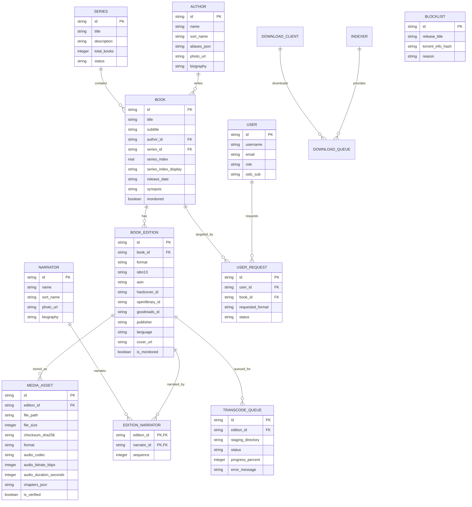

# Callimachus: Domain & Database Data Model Specification

> **Document Version:** 1.0.0  
> **Status:** Approved Specification  
> **Database Engine:** SQLite 3 (WAL Mode, Foreign Keys Enforced)  
> **Repository:** `t0ggl/callimachus`

---

## 1. Architectural Principles of the Data Model

The Callimachus data model is purpose-built to solve the historical structural shortcomings of book management tools (Shelfmark, Readarr, manual Calibre directories):

1. **Strict Separation of Work (Book) vs. Edition:**
   - A **Book** represents the conceptual intellectual work (e.g. *The Martian* by Andy Weir, published in 2014).
   - A **BookEdition** represents a specific release format and production of that work: EPUB eBook, Audible Audiobook (Wil Wheaton narration), Audible Audiobook (R.C. Bray narration), or GraphicAudio dramatization.
   - A **MediaAsset** represents the actual file(s) on disk (paths, hashes, codecs, bitrates, audio chapter structures).

2. **First-Class Narrators:**
   - In audiobook collections, the narrator is as vital as the author. Users frequently follow specific voice actors (Ray Porter, Travis Baldree, Michael Kramer, Kate Reading) regardless of author.
   - The model maintains a dedicated `narrators` table and an `edition_narrators` join table to support multi-narrator casts, narrator filtering, and voice actor discovery.

3. **Floating-Point Series Indexing:**
   - Real book series feature prequels (`#0.5`), novellas (`#1.5`, `#2.5`), and multi-book collections (`#1.0-#3.0`).
   - `series_index` is stored as `REAL` (floating-point number), paired with an optional `series_index_display` text string (e.g. `Novella 2.5` or `Book 1`). Sorting is always arithmetic.

4. **Normalized Multi-Source Identifiers:**
   - Different formats use distinct identifier ecosystems: eBooks rely on ISBN-10/13, audiobooks rely on Audible ASINs, while community metadata relies on Hardcover IDs, OpenLibrary IDs, and Goodreads IDs.
   - All external IDs are indexed and queryable across editions.

5. **Decoupled Transcode Queue:**
   - Transcoding multi-part audiobooks to `.m4b` is handled via an asynchronous, persistent FIFO queue in SQLite with explicit state machines (`pending`, `processing`, `completed`, `failed`).

---

## 2. Entity-Relationship Diagram



---

## 3. Detailed Entity & Table Definitions

### 3.1 `authors`
Stores primary author and creator profiles.

| Column | Type | Constraints | Description |
|---|---|---|---|
| `id` | `TEXT` | `PRIMARY KEY` | ULID or UUIDv4 identifier |
| `name` | `TEXT` | `NOT NULL` | Canonical author name (e.g. `Andy Weir`) |
| `sort_name` | `TEXT` | `NOT NULL` | Directory/sorting name (e.g. `Weir, Andy`) |
| `aliases_json` | `TEXT` | `DEFAULT '[]'` | JSON array of pseudonyms and alias strings |
| `photo_url` | `TEXT` | `NULL` | Cached local or remote image URL |
| `biography` | `TEXT` | `NULL` | Markdown or plain text author biography |
| `created_at` | `TEXT` | `NOT NULL` | ISO 8601 UTC timestamp |
| `updated_at` | `TEXT` | `NOT NULL` | ISO 8601 UTC timestamp |

*Indices:* `CREATE INDEX idx_authors_name ON authors(name);`

---

### 3.2 `narrators`
Stores audiobook voice actors and narrators as first-class citizens.

| Column | Type | Constraints | Description |
|---|---|---|---|
| `id` | `TEXT` | `PRIMARY KEY` | ULID or UUIDv4 identifier |
| `name` | `TEXT` | `NOT NULL` | Full narrator name (e.g. `Ray Porter`, `Travis Baldree`) |
| `sort_name` | `TEXT` | `NOT NULL` | Sorting name (e.g. `Porter, Ray`) |
| `photo_url` | `TEXT` | `NULL` | Portrait image URL |
| `biography` | `TEXT` | `NULL` | Biography and credit highlights |
| `created_at` | `TEXT` | `NOT NULL` | ISO 8601 UTC timestamp |
| `updated_at` | `TEXT` | `NOT NULL` | ISO 8601 UTC timestamp |

*Indices:* `CREATE INDEX idx_narrators_name ON narrators(name);`

---

### 3.3 `series`
Represents named book sequences.

| Column | Type | Constraints | Description |
|---|---|---|---|
| `id` | `TEXT` | `PRIMARY KEY` | ULID or UUIDv4 identifier |
| `title` | `TEXT` | `NOT NULL` | Series title (e.g. `The Expanse`, `Bobiverse`) |
| `description` | `TEXT` | `NULL` | Overview synopsis of the series |
| `total_books` | `INTEGER`| `DEFAULT 0` | Total known published/announced books |
| `status` | `TEXT` | `DEFAULT 'continuing'`| `continuing`, `ended`, `hiatus` |
| `created_at` | `TEXT` | `NOT NULL` | ISO 8601 UTC timestamp |
| `updated_at` | `TEXT` | `NOT NULL` | ISO 8601 UTC timestamp |

*Indices:* `CREATE INDEX idx_series_title ON series(title);`

---

### 3.4 `books`
Represents the intellectual work (independent of physical or digital format).

| Column | Type | Constraints | Description |
|---|---|---|---|
| `id` | `TEXT` | `PRIMARY KEY` | ULID or UUIDv4 identifier |
| `title` | `TEXT` | `NOT NULL` | Book title (e.g. `Project Hail Mary`) |
| `subtitle` | `TEXT` | `NULL` | Subtitle |
| `author_id` | `TEXT` | `NOT NULL, FK -> authors(id)` | Primary author |
| `series_id` | `TEXT` | `NULL, FK -> series(id)` | Associated series (if part of one) |
| `series_index`| `REAL` | `NULL` | Numeric order (`1.0`, `2.5`, `0.5`) |
| `series_index_display`| `TEXT` | `NULL` | Display label (e.g. `Novella 2.5`) |
| `release_date` | `TEXT` | `NULL` | YYYY-MM-DD publication date |
| `synopsis` | `TEXT` | `NULL` | Overview / blurb |
| `monitored` | `INTEGER`| `NOT NULL DEFAULT 1` | `1` to automatically monitor for releases |
| `created_at` | `TEXT` | `NOT NULL` | ISO 8601 UTC timestamp |
| `updated_at` | `TEXT` | `NOT NULL` | ISO 8601 UTC timestamp |

*Indices:*
- `CREATE INDEX idx_books_author_id ON books(author_id);`
- `CREATE INDEX idx_books_series_id ON books(series_id, series_index);`
- `CREATE INDEX idx_books_monitored ON books(monitored);`

---

### 3.5 `book_editions`
Represents a concrete published edition of a book work.

| Column | Type | Constraints | Description |
|---|---|---|---|
| `id` | `TEXT` | `PRIMARY KEY` | ULID or UUIDv4 identifier |
| `book_id` | `TEXT` | `NOT NULL, FK -> books(id)` | Parent work |
| `format` | `TEXT` | `NOT NULL` | `epub`, `m4b`, `pdf`, `azw3` |
| `isbn13` | `TEXT` | `NULL` | Normalized 13-digit ISBN |
| `asin` | `TEXT` | `NULL` | Amazon / Audible ASIN |
| `hardcover_id` | `TEXT` | `NULL` | Hardcover.app unique book ID |
| `openlibrary_id`| `TEXT` | `NULL` | OpenLibrary edition key |
| `goodreads_id` | `TEXT` | `NULL` | Goodreads book ID |
| `publisher` | `TEXT` | `NULL` | Publishing house |
| `publication_date`| `TEXT` | `NULL` | Edition-specific release date |
| `language` | `TEXT` | `NOT NULL DEFAULT 'en'` | ISO 639-1 language code |
| `cover_url` | `TEXT` | `NULL` | High-res cover image URL |
| `is_monitored`| `INTEGER`| `NOT NULL DEFAULT 1` | Whether this edition is tracked |
| `created_at` | `TEXT` | `NOT NULL` | ISO 8601 UTC timestamp |
| `updated_at` | `TEXT` | `NOT NULL` | ISO 8601 UTC timestamp |

*Indices:*
- `CREATE INDEX idx_editions_book_id ON book_editions(book_id);`
- `CREATE INDEX idx_editions_isbn13 ON book_editions(isbn13);`
- `CREATE INDEX idx_editions_asin ON book_editions(asin);`
- `CREATE INDEX idx_editions_format ON book_editions(format);`

---

### 3.6 `edition_narrators`
Join table connecting audiobook editions with their voice actors/narrators.

| Column | Type | Constraints | Description |
|---|---|---|---|
| `edition_id` | `TEXT` | `NOT NULL, FK -> book_editions(id) ON DELETE CASCADE` | Audiobook edition |
| `narrator_id` | `TEXT` | `NOT NULL, FK -> narrators(id) ON DELETE CASCADE` | Narrator |
| `sequence` | `INTEGER` | `NOT NULL DEFAULT 1` | Order of narrator credit |

*Primary Key:* `PRIMARY KEY (edition_id, narrator_id)`

---

### 3.7 `media_assets`
Physical media file on disk associated with a specific edition.

| Column | Type | Constraints | Description |
|---|---|---|---|
| `id` | `TEXT` | `PRIMARY KEY` | ULID or UUIDv4 identifier |
| `edition_id` | `TEXT` | `NOT NULL, FK -> book_editions(id) ON DELETE CASCADE` | Linked edition |
| `file_path` | `TEXT` | `NOT NULL UNIQUE` | Absolute path in canonical library |
| `file_size` | `INTEGER`| `NOT NULL` | Size in bytes |
| `checksum_sha256`| `TEXT` | `NULL` | SHA256 file checksum |
| `format` | `TEXT` | `NOT NULL` | Extension (`epub`, `m4b`, etc.) |
| `audio_codec` | `TEXT` | `NULL` | Audio codec (e.g. `aac`) |
| `audio_bitrate_kbps`| `INTEGER`| `NULL` | Audio bitrate (e.g. `64`, `128`) |
| `audio_duration_seconds`| `INTEGER`| `NULL` | Total runtime in seconds |
| `chapters_json` | `TEXT` | `DEFAULT '[]'` | JSON array of chapter titles and offsets |
| `is_verified` | `INTEGER`| `NOT NULL DEFAULT 1` | 1 if file passed structural validation |
| `created_at` | `TEXT` | `NOT NULL` | ISO 8601 UTC timestamp |
| `updated_at` | `TEXT` | `NOT NULL` | ISO 8601 UTC timestamp |

*Indices:*
- `CREATE INDEX idx_assets_edition_id ON media_assets(edition_id);`
- `CREATE INDEX idx_assets_file_path ON media_assets(file_path);`

---

### 3.8 `transcode_queue`
FIFO queue tracking single-job audio transcoding tasks.

| Column | Type | Constraints | Description |
|---|---|---|---|
| `id` | `TEXT` | `PRIMARY KEY` | ULID identifier |
| `edition_id` | `TEXT` | `NOT NULL, FK -> book_editions(id)` | Target audiobook edition |
| `staging_directory`| `TEXT` | `NOT NULL` | Staging folder with unpacked MP3/M3U files |
| `output_file_path`| `TEXT` | `NOT NULL` | Target `.m4b` destination path |
| `status` | `TEXT` | `NOT NULL DEFAULT 'pending'` | `pending`, `processing`, `completed`, `failed`, `cancelled` |
| `progress_percent`| `INTEGER`| `NOT NULL DEFAULT 0` | Transcode completion progress (0-100) |
| `error_message` | `TEXT` | `NULL` | Error details if failed |
| `retry_count` | `INTEGER`| `NOT NULL DEFAULT 0` | Number of retry attempts |
| `created_at` | `TEXT` | `NOT NULL` | ISO 8601 UTC timestamp |
| `updated_at` | `TEXT` | `NOT NULL` | ISO 8601 UTC timestamp |

*Indices:* `CREATE INDEX idx_transcode_status ON transcode_queue(status, created_at);`

---

### 3.9 `blocklist`
Prevents redownloading bad or unwanted releases.

| Column | Type | Constraints | Description |
|---|---|---|---|
| `id` | `TEXT` | `PRIMARY KEY` | ULID identifier |
| `release_title` | `TEXT` | `NOT NULL` | Raw torrent or usenet release string |
| `torrent_info_hash`| `TEXT` | `NULL UNIQUE` | 40-char SHA1 info-hash |
| `indexer` | `TEXT` | `NULL` | Originating indexer name |
| `reason` | `TEXT` | `NOT NULL` | Rejection reason (e.g. `wrong_book`, `corrupt_archive`) |
| `created_at` | `TEXT` | `NOT NULL` | ISO 8601 UTC timestamp |

*Indices:* `CREATE INDEX idx_blocklist_hash ON blocklist(torrent_info_hash);`

---

### 3.10 `users` & `user_requests`
Multi-user system and Overseerr-style book request workflow.

**`users`:**
| Column | Type | Constraints | Description |
|---|---|---|---|
| `id` | `TEXT` | `PRIMARY KEY` | ULID identifier |
| `username` | `TEXT` | `NOT NULL UNIQUE` | Username |
| `email` | `TEXT` | `NOT NULL UNIQUE` | Email address |
| `password_hash` | `TEXT` | `NULL` | Bcrypt hash (null if pure OIDC / env admin) |
| `role` | `TEXT` | `NOT NULL DEFAULT 'user'` | `admin`, `curator`, `user`, `guest` |
| `oidc_sub` | `TEXT` | `NULL UNIQUE` | OIDC subject claim identifier |
| `created_at` | `TEXT` | `NOT NULL` | ISO 8601 UTC timestamp |
| `updated_at` | `TEXT` | `NOT NULL` | ISO 8601 UTC timestamp |

**`user_requests`:**
| Column | Type | Constraints | Description |
|---|---|---|---|
| `id` | `TEXT` | `PRIMARY KEY` | ULID identifier |
| `user_id` | `TEXT` | `NOT NULL, FK -> users(id)` | Requesting user |
| `book_id` | `TEXT` | `NOT NULL, FK -> books(id)` | Requested book work |
| `requested_format`| `TEXT` | `NOT NULL` | `epub`, `m4b`, `any` |
| `status` | `TEXT` | `NOT NULL DEFAULT 'pending'` | `pending`, `approved`, `declined`, `fulfilled` |
| `notes` | `TEXT` | `NULL` | User notes or admin decline reason |
| `created_at` | `TEXT` | `NOT NULL` | ISO 8601 UTC timestamp |
| `updated_at` | `TEXT` | `NOT NULL` | ISO 8601 UTC timestamp |

---

## 4. Query Patterns & Common Access Paths

1. **Library Overview by Author & Series:**
   ```sql
   SELECT b.id, b.title, b.series_index, b.release_date,
          be.id AS edition_id, be.format, ma.file_path, ma.file_size
   FROM books b
   LEFT JOIN book_editions be ON b.id = be.book_id
   LEFT JOIN media_assets ma ON be.id = ma.edition_id
   WHERE b.author_id = ?
   ORDER BY b.series_id, b.series_index ASC;
   ```

2. **Series Completion Rate:**
   ```sql
   SELECT s.id, s.title, s.total_books,
          COUNT(DISTINCT b.id) AS registered_books,
          COUNT(DISTINCT CASE WHEN ma.id IS NOT NULL THEN b.id END) AS acquired_books
   FROM series s
   JOIN books b ON s.id = b.series_id
   LEFT JOIN book_editions be ON b.id = be.book_id
   LEFT JOIN media_assets ma ON be.id = ma.edition_id
   GROUP BY s.id;
   ```

3. **Audiobooks by Narrator:**
   ```sql
   SELECT b.title, a.name AS author_name, be.asin, ma.audio_duration_seconds
   FROM narrators n
   JOIN edition_narrators en ON n.id = en.narrator_id
   JOIN book_editions be ON en.edition_id = be.id
   JOIN books b ON be.book_id = b.id
   JOIN authors a ON b.author_id = a.id
   LEFT JOIN media_assets ma ON be.id = ma.edition_id
   WHERE n.id = ?;
   ```

4. **FIFO Transcoder Queue Worker Polling:**
   ```sql
   -- Poll single next job atomically
   UPDATE transcode_queue
   SET status = 'processing', updated_at = CURRENT_TIMESTAMP
   WHERE id = (
       SELECT id FROM transcode_queue
       WHERE status = 'pending'
       ORDER BY created_at ASC
       LIMIT 1
   )
   RETURNING *;
   ```
