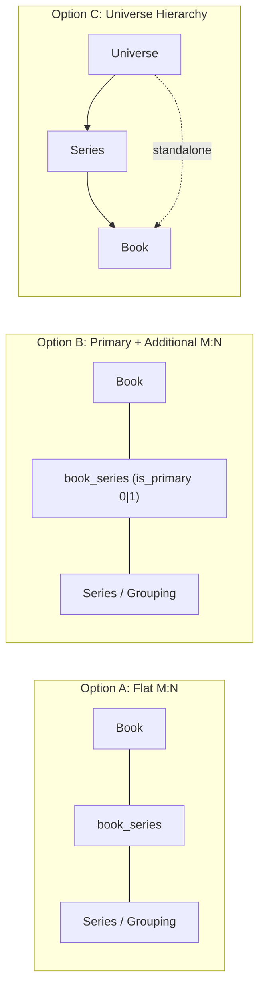

# Callimachus: Multi-Series Book Membership Investigation & Proposal

> **Document Version:** 0.1.0\
> **Status:** Proposal — Awaiting Decision\
> **Issue:** [#109](https://github.com/t0ggl/callimachus/issues/109)\
> **Repository:** `t0ggl/callimachus`

---

## 1. Problem Statement & Current Constraints

Callimachus currently models a book as belonging to **zero or one** series. In practice, books routinely belong to multiple overlapping groupings—most famously Brandon Sanderson's **Cosmere** (which encompasses *The Stormlight Archive*, *Mistborn*, *Elantris*, and three of four *Secret Projects*), as well as Terry Pratchett's *Discworld* sub-series, Orson Scott Card's *Enderverse*, and shared worlds like *Forgotten Realms* or *Star Wars*.

### Current Single-Series Touchpoints in the Codebase

| Area | Current Implementation | Single-Series Limitation |
|---|---|---|
| **SQLite Schema** | `books.series_id`, `books.series_index`, `books.series_index_display` (`0001_initial_schema.sql`); `series.author_id`, `series.hardcover_id` (`0014_series_identity.sql`); `book_ideal_metadata(book_id, title, series, series_index)` (`0015_book_ideal_metadata.sql`) | One FK and one float position per book; no join table for additional memberships. |
| **Metadata Providers** | `HardcoverProvider` fetches `featured_book_series` and `book_series[]`, then collapses to one via `primaryHardcoverMembership()` (`pkg/metadata/hardcover.go:321`); `AudnexusProvider` reads `res.Series[0]` only (`pkg/metadata/audnexus.go:158`); OpenLibrary and Google Books expose no structured series field. | Secondary memberships are discarded at fetch time; unfeatured ties in Hardcover return `nil` (dropping all series). |
| **Canonical On-Disk Layout** | `{LibraryRoot}/{Author}/{Series}/{Title} ({Year})/{Title} ({Year}) - {Author}.{ext}` or standalone without `{Series}` (`pkg/catalog/organizer.go:72`, `AGENTS.md` §1.4). Zero symlinks enforced (`ErrSymlinkForbidden`). | Exactly zero or one series directory segment. `ScanLibrary()` (`pkg/catalog/scanner.go:345`), `IngestConvertedAudio()` (`pkg/catalog/catalog.go:1050`), and `inferredSeriesFromRelPath()` (`cmd/callimachus/epub_mismatches.go:282`) all assume depth 2 or 3. |
| **EPUB & Sidecar OPF** | `pkg/epub/opf.go` parses/writes one `calibre:series` + `calibre:series_index` and stops at the first EPUB 3 `belongs-to-collection`. `pkg/epub/sidecar.go` generates Calibre OPF 2.0. | Calibre OPF 2.0 supports one series; EPUB 3 supports repeated `belongs-to-collection` elements, currently unused. |
| **Discovery & Monitoring** | `mergeDiscoveryBook()` (`cmd/callimachus/discovery.go:530`) keeps one series. `Monitor.persist()` (`pkg/catalog/monitor.go:233`) assigns `book.SeriesID` to the monitored series, while `backfillBookFields()` (`pkg/catalog/catalog.go:191`) refuses to overwrite an existing `SeriesID`. | Monitoring both *The Stormlight Archive* and *The Cosmere* causes whichever is discovered first to claim the book; the second series view omits owned books. |
| **Metadata Repair & Mismatches** | `cmd/callimachus/book_metadata.go` and `epub_mismatches.go` diff one `series`/`seriesIndex`, relocate files when `series` changes (`shouldRelocateEPUB`), and flag copies under two series directories as duplicates. | Changing series always triggers disk relocation; no way to add/edit secondary groupings independently. |
| **UI & Search** | `CatalogView` (`bundleSeriesInLibrary` groups by `book.seriesId`), `EntityView` (author view partitions into disjoint series sections), `SeriesDetailModal`, `BookDetailModal`, `SeriesBadge`, `CommandPalette`, and `library_bulk.go` all read singular `seriesId`/`seriesTitle`/`seriesIndex`. | Books can only appear in one series card/list, and searching a secondary series name returns no library books. |

---

## 2. Candidate Data Models

### Option A: Multiple Equal Series Memberships (Flat Many-to-Many)

Every series or universe is a peer row in `series`, linked to books via a many-to-many join table with no primary distinction.

```sql
CREATE TABLE book_series (
    book_id TEXT NOT NULL REFERENCES books(id) ON DELETE CASCADE,
    series_id TEXT NOT NULL REFERENCES series(id) ON DELETE CASCADE,
    series_index REAL,
    series_index_display TEXT,
    source TEXT NOT NULL DEFAULT 'import', -- manual_repair > match > import > scan
    created_at TIMESTAMP NOT NULL DEFAULT CURRENT_TIMESTAMP,
    updated_at TIMESTAMP NOT NULL DEFAULT CURRENT_TIMESTAMP,
    PRIMARY KEY (book_id, series_id)
);
CREATE INDEX idx_book_series_order ON book_series(series_id, series_index);
```

- **Key trait:** All memberships are equal. Any single-slot surface (disk path, Calibre OPF, bundled library card) must derive a winner via an implicit tie-breaker (e.g., alphabetical, smallest series, lowest index, or oldest row).

### Option B: Primary Series + Additional Series / Groupings (Primary-Designated M:N)

Uses the same unified `series` table and `book_series` join table as Option A, but designates **at most one** membership per book as primary (`is_primary = 1`).

```sql
CREATE TABLE book_series (
    book_id TEXT NOT NULL REFERENCES books(id) ON DELETE CASCADE,
    series_id TEXT NOT NULL REFERENCES series(id) ON DELETE CASCADE,
    series_index REAL,
    series_index_display TEXT,
    is_primary INTEGER NOT NULL DEFAULT 0 CHECK (is_primary IN (0, 1)),
    source TEXT NOT NULL DEFAULT 'import',
    created_at TIMESTAMP NOT NULL DEFAULT CURRENT_TIMESTAMP,
    updated_at TIMESTAMP NOT NULL DEFAULT CURRENT_TIMESTAMP,
    PRIMARY KEY (book_id, series_id)
);
CREATE UNIQUE INDEX idx_book_series_primary ON book_series(book_id) WHERE is_primary = 1;
CREATE INDEX idx_book_series_order ON book_series(series_id, series_index);
```

- **Sub-variant note (unified `series` vs. separate `collections`/`universes` table):** Keeping a single `series` table (optionally with an informational `series.kind` column such as `'series' | 'universe' | 'collection'` for UI labeling) is strongly preferable to splitting out a second `groupings` table. A unified table lets secondary groupings reuse `series.hardcover_id`, reading-order views, monitoring, and `EntityLink` without duplicating tables, routes, and bulk actions, and naturally represents overlapping peer series (e.g., *Discworld* and *City Watch*).
- **Key trait:** Exactly one explicit membership drives all single-slot invariants (canonical disk path, Calibre OPF / EPUB 2 tag, `bundleSeriesInLibrary`, mismatch comparison), while all memberships are first-class for browsing, reading order, search, and monitoring. A book can also have **zero** primary memberships and one or more secondary memberships (e.g., a standalone novel tied to a shared universe).

### Option C: Explicit Hierarchy of Universes → Series → Books (3-Tier Tree)

Introduces a distinct `universes` entity above `series`, with books attaching either to a series (inheriting its universe) or directly to a universe for in-universe standalones.

```sql
CREATE TABLE universes (
    id TEXT PRIMARY KEY,
    title TEXT NOT NULL,
    description TEXT,
    author_id TEXT REFERENCES authors(id) ON DELETE SET NULL,
    hardcover_id INTEGER,
    monitored INTEGER NOT NULL DEFAULT 0,
    discovery_checked_at TEXT,
    created_at TIMESTAMP NOT NULL DEFAULT CURRENT_TIMESTAMP,
    updated_at TIMESTAMP NOT NULL DEFAULT CURRENT_TIMESTAMP
);
-- series gains: universe_id TEXT REFERENCES universes(id) ON DELETE SET NULL, universe_order REAL
-- books keeps:  series_id, series_index
-- books gains:  universe_id TEXT REFERENCES universes(id) ON DELETE SET NULL, universe_index REAL
```

- **Key trait:** Models containment (`Universe → Series → Book`) explicitly. Requires either a rigid 2-level hierarchy (`universes` + `series`) or a recursive self-join (`series.parent_series_id`) with cycle guards and recursive CTEs.



---

## 3. Concrete Examples & Edge Cases

### 3.1 Brandon Sanderson / Cosmere Walkthrough

| Book | Real-World Relationships | Option A (Flat M:N) | Option B (Primary + Additional) | Option C (Universe → Series → Book) |
|---|---|---|---|---|
| **The Way of Kings** (2010) | *The Stormlight Archive* #1; *The Cosmere* (chronological/pub order) | Two equal rows: `(Stormlight, 1.0)`, `(Cosmere, 6.0)`. Path & bundle choice is implicit. | Primary: `(Stormlight, 1.0)`; Additional: `(Cosmere, 6.0)`. Path uses `Stormlight`. | `Universe(Cosmere)` → `Series(Stormlight)` → Book #1. Needs extra `universe_index` to interleave Cosmere reading order. |
| **Edgedancer** (2016) | *The Stormlight Archive* #2.5 (novella); *The Cosmere* | Two equal rows: `(Stormlight, 2.5)`, `(Cosmere, NULL/11.5)`. | Primary: `(Stormlight, 2.5)`; Additional: `(Cosmere, NULL/11.5)`. | Works like *Way of Kings*, same interleaving caveat. |
| **Elantris** (2005) | Standalone novel inside *The Cosmere* (no sub-series) | One row: `(Cosmere, 1.0)`. | Either Primary: `(Cosmere, 1.0)` **or** Standalone (no primary) + Additional: `(Cosmere, 1.0)` (see §8 decision point). | `series_id = NULL`, `universe_id = Cosmere`. Universe queries must union direct books + child-series books. |
| **Mistborn: The Final Empire** (2006) | *Mistborn* #1, *Mistborn Era 1* #1, *The Cosmere* (3 levels) | Three equal rows cleanly stored. | Primary: `(Mistborn, 1.0)` (or `Era 1`); Additional: `(Mistborn Era 1, 1.0)`, `(Cosmere, 2.0)`. | **Breaks 2-level tree:** cannot nest `Era 1 → Mistborn → Cosmere` without switching to arbitrary-depth recursive trees. |
| **The Sunlit Man** (2023) & **Frugal Wizard** (2023) | *Secret Projects* #1, #3, #4 are Cosmere; **#2 (*Frugal Wizard*) is NOT Cosmere**. | Works cleanly: *Sunlit Man* has `(Secret Projects, 4.0)` + `(Cosmere, ...)`; *Frugal Wizard* has only `(Secret Projects, 2.0)`. | Works cleanly: *Sunlit Man* has Primary `(Secret Projects, 4.0)` + Additional `(Cosmere, ...)`; *Frugal Wizard* has Primary `(Secret Projects, 2.0)`. | **Breaks strict tree:** *Secret Projects* cannot be a child of *Cosmere* because book #2 is non-Cosmere. Partial overlap is a DAG/set problem, not a tree. |

### 3.2 Additional Edge Cases

1. **Parallel Independent Reading Orders:** *Guards! Guards!* is both *Discworld* #8 and *City Watch* #1; *Ender's Shadow* is *Shadow Saga* #1 and *Enderverse* #5. Both Option A and Option B represent per-series `REAL` positions cleanly; Option C struggles because *Discworld* sub-series overlap non-hierarchically (e.g., *Thief of Time* spans *Death* and *History Monks*).
2. **Loose Crossovers / Unindexed Tie-Ins:** Stephen King's *'Salem's Lot* is a standalone novel that connects to *The Dark Tower* without a numbered slot. Option B models this naturally as standalone on disk (no primary series) with an unindexed additional membership in *The Dark Tower*.
3. **Multi-Author Shared Worlds:** *Forgotten Realms* (R.A. Salvatore's *Legend of Drizzt* plus dozens of other authors) or *Star Wars*. Note that `pkg/catalog/series.go:20` (`seriesAuthorMatch`) and `SeriesEvidence()` (`pkg/catalog/series.go:97`) currently reject mixed-author legacy series unless pinned by `hardcover_id`. Multi-author universes require relying on `hardcover_id` (or explicit multi-author/unowned series handling) rather than single-author ownership.
4. **Identical Series Names by Different Authors:** Preserved across all options by keeping `series.hardcover_id` and `series.author_id` from migration `0014_series_identity.sql`.
5. **Compilations / Omnibuses:** Filtered out by commit `b9e8d4e` (`compilation: true` in Hardcover, `IsCollectionTitle`). Multi-series membership applies strictly to single works belonging to multiple series, not box sets.

---

## 4. Comparison Across System Dimensions

| Dimension | Option A: Flat Equal M:N | Option B: Primary + Additional M:N | Option C: Universe → Series → Book |
|---|---|---|---|
| **Provider Ingestion** | **Strong fit.** Direct mirror of Hardcover `book_series[]` and Audnexus `series[]`, but discards Hardcover's `featured` signal. | **Best fit.** Preserves all Hardcover `book_series[]` and Audnexus `series[]` **and** uses `featured_book_series` / `series[0]` to choose the primary membership. | **Poor fit.** Neither Hardcover, Audnexus, OpenLibrary, Google Books, nor OPF distinguish universes from series. Requires brittle heuristics or manual curation to classify every grouping. |
| **Series Order** | Clean per-membership `series_index` (`REAL`) + fallback sort `(release_date, title)`. | Clean per-membership `series_index` (`REAL`) + fallback sort `(release_date, title)`. Interleaved universe reading orders work out of the box. | Series order works, but interleaved universe reading order (e.g., Cosmere publication/chronological order across *Stormlight* and *Mistborn*) requires adding a separate `books.universe_index` anyway. |
| **Canonical On-Disk Path** | **Problematic.** No stable choice for `{Series}` in `{Author}/{Series}/{Title} ({Year})/...`. Adding a secondary series could silently move files unless a hidden "path series" column is added (which recreates Option B). | **Seamless.** Uses the primary series only—100% compatible with `AGENTS.md` §1.4, `ResolveCanonicalPath()`, `ScanLibrary()`, `IngestConvertedAudio()`, and the zero-symlink rule. Adding/removing secondary series never moves files. | **Risky.** Either adds a 4th path segment `{Author}/{Universe}/{Series}/{Title}` (breaking `ScanLibrary`, `IngestConvertedAudio`, Calibre/ABS layouts, and moving existing libraries) or ignores universe on disk (losing parity). |
| **EPUB & OPF Sidecars** | Ambiguous which series populates single-slot `calibre:series` (OPF 2.0 / EPUB 2). | `calibre:series` + primary EPUB 3 `belongs-to-collection` use primary; EPUB 3 can optionally emit additional `belongs-to-collection` entries (`collection-type="series"` or `"set"`). | Same single-slot OPF 2.0 limitation; no standard Calibre field for universe. |
| **Library View (`CatalogView`)** | `bundleSeriesInLibrary` either duplicates a book across multiple series cards (breaking counts & bulk selection) or picks an arbitrary card. Series tab works well. | `bundleSeriesInLibrary` bundles each book **once** under its primary series (clean counts & bulk actions). Series tab lists every series/universe with all member books. | Requires either nested cards (Universe → Series → Books), a new "Universes" tab, or flattening—high UI density cost for a feature only needed by a subset of libraries. |
| **Author View (`EntityView`)** | `groupAuthorBooks()` either duplicates books in every series section (inflating counts) or hides extra memberships. | Groups cleanly by primary series with zero duplicate book rows, plus secondary-membership links/chips (and optional "Shared Universes / Other Series" index section). | Visually nice for clean trees (Cosmere → Stormlight / Mistborn / Standalones), but breaks on overlapping series (*Secret Projects* / *Discworld*). |
| **Series View & Monitoring** | Uniform `series` monitoring works; `Monitor.persist()` adds a `book_series` row without clobbering existing memberships. | Same clean uniform `series` monitoring; discovering a book via a monitored secondary series attaches the secondary row without changing the book's primary series or disk path. | Splits monitoring across 3 entity types (`authors`, `series`, `universes`); requires updating `catalog_actions` CHECK constraint and defining cascading monitor/unmonitor rules. |
| **Search (`CommandPalette`, Filter, `/api/discover`)** | Matches any attached series title cleanly. | Matches primary + all additional series titles cleanly; `DiscoveryResults` can show primary badge + secondary chips (e.g., `+ Cosmere`). | Must index and display a third entity type (`Universe`) in `CommandPalette` and search endpoints. |
| **Metadata Corrections & Mismatches** | Mismatch detection is ambiguous when EPUB carries one series and DB has several equal ones. `Fix Metadata` lacks a clear rule for when to relocate files. | **Clear contract:** EPUB mismatch check compares against primary ideal series; `Fix Metadata` previews relocation **only** when primary series changes, while allowing secondary memberships to be added/removed in-place. | `Fix Metadata` must manage both `universe` and `series` pickers and guard against invalid tree combinations (e.g., book's series belongs to Universe X while book is edited to Universe Y). |
| **Implementation & Maintenance Cost** | Low schema cost, high edge-case cost in UI/path heuristics. | **Low-to-moderate cost.** One join table (`book_series`), reuses all existing `series` infrastructure and canonical paths. | **High cost.** New table, new routes, new entity view, new bulk/monitor kind, tree/union queries, and manual universe curation UX. |

---

## 5. Handling Ordering, Ambiguity & Conflicting Provider Evidence

Regardless of the chosen model, multi-series ingestion introduces new conflict cases that must be handled deterministically (consistent with `AGENTS.md` §1.2):

### 5.1 Series Ordering Within Each Membership
- Each `(book_id, series_id)` row carries its own nullable `series_index REAL` and `series_index_display TEXT`.
- Series reading order continues to sort by `(series_index IS NULL, series_index ASC, release_date ASC, title COLLATE NOCASE ASC, book_id ASC)`—matching `cmd/callimachus/series.go:261` and `cmd/callimachus/monitor.go:291`.
- Fractional indices (`0.5`, `1.5`, `2.5`) remain first-class per membership, and unindexed entries (common in broad universes like *The Cosmere* or *The Dark Tower* tie-ins) sort cleanly after numbered entries by publication date.

### 5.2 Choosing Primary Series (Option B) & Resolving Provider Conflicts

When a book has multiple candidate memberships, resolve primary status with a strict precedence chain:

1. **Curator / Admin manual override (`source = 'manual_repair'`)** always wins and is never overwritten by automated refresh, scan, or monitoring.
2. **Existing primary membership on an already-organized library book** is preserved during background refresh/monitoring (so background jobs never silently move files on disk); new memberships are appended as `is_primary = 0`.
3. **Hardcover `featured_book_series`** (excluding `compilation: true`), canonicalized via `series.canonical_id` / `series.canonical`.
4. **Hardcover `book_series[]` tie-breaker when `featured_book_series` is null:**
   - Prefer a membership with `featured = true`.
   - Else prefer a membership whose credited `series.author` matches the book's author (`SharesAuthor`) and has a non-null `series_position`.
   - Else prefer the more specific series (smaller `books_count` when non-zero—e.g., *The Stormlight Archive* (5) over *The Cosmere* (25+)).
   - Unlike today's `primaryHardcoverMembership()` (which returns `nil` on ties), keep **all** valid memberships and deterministically pick a primary (or leave primary unset if genuinely unranked until user confirmation).
5. **Audnexus `series[]` fallback:** `series[0]` is primary candidate, `series[1:]` are additional memberships (deduplicated by normalized series title against Hardcover results when merging in `mergeDiscoveryBook`).
6. **EPUB / OPF / Directory Scan (`source = 'scan'`):** Existing on-disk `{Series}` folder or `calibre:series` becomes the initial primary membership (`is_primary = 1`) until a user explicitly applies a metadata repair.

### 5.3 Conflicting Evidence Across Sources
- **Name variants & aliases:** Normalize via `seriesTitleKey()` (stripping leading `"The"`, punctuation) and Hardcover `canonical_id` so `"Stormlight Archive"` and `"The Stormlight Archive"` merge into one `series` row instead of duplicating.
- **Conflicting indices for the same series:** Keep higher-precedence `source` (`manual_repair > match > import > scan`); if same source tier, prefer Hardcover pinned by `hardcover_series_id` over unpinned text matches, and prefer non-null over null.
- **Standalone book inside a universe (e.g., *Elantris*):** If a book's only provider membership is a broad shared universe, two policies are possible:
  - *Policy 1 (Uniform):* Any single membership becomes primary (`Elantris` lives under `Brandon Sanderson/The Cosmere/Elantris (2005)/`). Zero special cases, matches Hardcover's `featured_book_series`.
  - *Policy 2 (Opt-in standalone path):* Allow a book to have `is_primary = 0` on all memberships so it remains at `Brandon Sanderson/Elantris (2005)/` on disk while still appearing inside *The Cosmere* series view.
  - Option B supports **both** cleanly (defaulting to Policy 1 when a provider marks it featured, while allowing curators to unset primary in `Fix Metadata` to keep a book standalone on disk).
- **Multi-author shared worlds & `SeriesEvidence`:** In `pkg/catalog/series.go`, a series pinned with `hardcover_id` already bypasses the single-author check (`pkg/catalog/series.go:104`). For unpinned multi-author series, require explicit `hardcover_id` pinning or user selection before running automated discovery, avoiding cross-author false merges.

---

## 6. Migration Strategy for Existing Data

Assuming Option B (with the same table backfill applying to Option A):

1. **Additive SQLite Migration (`0016_book_series.sql`):**
   - Create `book_series` with `PRIMARY KEY (book_id, series_id)` and `CREATE UNIQUE INDEX idx_book_series_primary ON book_series(book_id) WHERE is_primary = 1`.
   - Backfill every existing non-null `books.series_id`:
     ```sql
     INSERT INTO book_series (book_id, series_id, series_index, series_index_display, is_primary, source)
     SELECT id, series_id, series_index, series_index_display, 1, 'import'
     FROM books
     WHERE series_id IS NOT NULL;
     ```
   - **Zero filesystem moves:** Every existing book retains its exact primary series and canonical path on disk.
   - **Zero data loss for monitoring & ideal metadata:** Existing `series.monitored`, `series.hardcover_id`, `catalog_actions`, and `book_ideal_metadata` remain valid without modification (since `book_ideal_metadata.series` maps cleanly to the primary ideal series).
2. **Transitional Compatibility (Backend & API):**
   - Keep `books.series_id`, `books.series_index`, `books.series_index_display` either synchronized with the `is_primary = 1` row during rollout or replaced in queries via a `LEFT JOIN book_series bs ON bs.book_id = b.id AND bs.is_primary = 1`, then drop the redundant columns in a follow-up migration once all queries and tests migrate.
   - In `APIBook` (`cmd/callimachus/api.go`) and `web/src/types/index.ts`, keep existing `seriesId`, `seriesTitle`, `seriesIndex`, `seriesIndexDisplay` populated from the primary membership for backward compatibility, and add `seriesMemberships: BookSeriesMembership[]` (ordered primary-first, then title) containing all memberships.
3. **Populating Secondary Memberships:**
   - Do **not** run bulk external API calls during DB migration.
   - Populate secondary memberships organically during:
     - New imports / acquisitions (`IngestBook`, `handleResolveBook`, `requests.Service`)
     - `Refresh Metadata` (single book and bulk library refresh)
     - Scheduled/manual `Monitor.persist` discovery runs (now attaching the discovered series row to `book_series` even when the book already has another primary series!)
     - Manual `Fix Metadata` edits.

*(By contrast, Option C migration cannot infer `universes` from existing SQLite rows at all; existing Cosmere/Stormlight libraries would require manual re-classification or provider-side heuristics after migration.)*

---

## 7. Recommendation

**Recommend Option B: Primary Series + Additional Series Memberships (unified `series` table + `book_series` join table with `is_primary`, no separate `universes` table).**

### Rationale
1. **Fits real-world provider data:** Hardcover's `featured_book_series` + `book_series[]` and Audnexus's ordered `series[]` map directly to Option B with zero loss of information and zero brittle "is this a universe?" guessing.
2. **Handles all real-world edge cases:** Supports Cosmere + Stormlight, 3-level *Mistborn Era 1* / *Mistborn* / *Cosmere*, partially overlapping sets like *Secret Projects* (#2 non-Cosmere vs. #1/#3/#4 Cosmere), parallel reading orders (*Discworld* + *City Watch*), and loose crossovers (*'Salem's Lot* + *Dark Tower*)—several of which break Option C's strict tree.
3. **Preserves Callimachus's filesystem & Calibre contracts:** Keeps `{Author}/{Series}/{Title} ({Year})/...`, zero symlinks, `ScanLibrary`, `IngestConvertedAudio`, Calibre OPF 2.0, `bundleSeriesInLibrary`, and EPUB mismatch detection deterministic and stable—solving Option A's biggest weakness.
4. **Low migration & maintenance risk:** Single join table (mirroring `edition_narrators`), additive migration with zero disk churn, uniform series monitoring, and leaves the door open to add an optional informational `series.kind` badge (`series` / `universe` / `collection`) later if desired without architectural rework.

---

## 8. Open Decisions Before Implementation

No implementation is assumed yet. Confirming the following decisions will lock the specification:

1. **Model selection:** Confirm **Option B** (Primary + Additional M:N in `book_series`) vs. Option A or Option C.
2. **Optional grouping label (`series.kind`):** Should all groupings be uniform `series` rows initially, or should `series` carry an optional display/filter kind (`series` vs. `universe`)?
3. **Standalone-in-universe disk path (e.g., *Elantris*):** When a book belongs only to a broad grouping (like *The Cosmere*), should it default to using that grouping as its primary series (placed under `{Author}/The Cosmere/{Title} ({Year})/`), with the option in `Fix Metadata` to unset primary so it lives at `{Author}/{Title} ({Year})/`?
4. **Author view presentation (`EntityView`):** Should an author's page group books strictly by primary series (showing secondary memberships as inline chips/links, plus an optional "Also in / Shared Groupings" index), so each book row appears once?
5. **EPUB 3 tag writing:** Should EPUB 2 / companion `.opf` sidecars continue writing only the primary series (`calibre:series`), while EPUB 3 files write primary + additional `belongs-to-collection` tags—or should EPUB 3 also stay primary-only initially to avoid unexpected diffs in external readers?
6. **Universe monitoring safeguard:** Because monitoring a large shared universe (e.g., *The Cosmere* or *Forgotten Realms*) via `Monitor` could queue many books, should monitoring behave identically to any series or show a confirmation/book-count hint?
